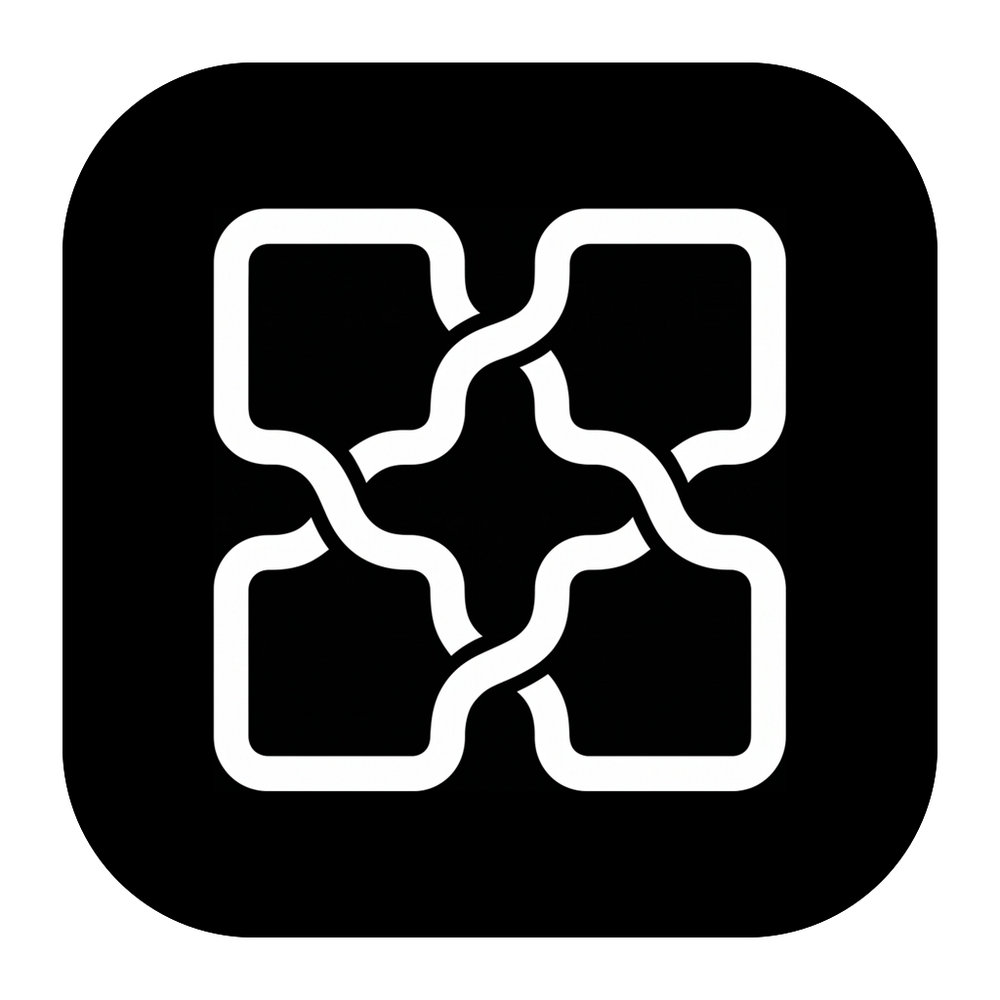
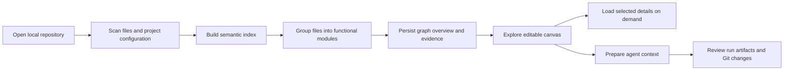

<p align="center">
  
</p>

<h1 align="center">FlowWeave</h1>

<p align="center">
  A local-first desktop workbench for understanding codebases and coordinating AI coding agents.
</p>

<p align="center">
  <a href="LICENSE.txt"></a>
  
  
  
</p>

FlowWeave helps developers inspect a local repository, explore its functional architecture, prepare context for coding agents, and review the resulting work. It brings project analysis, an editable module canvas, sequence diagrams, project notes, agent run records, and Git review into one Electron desktop application.

FlowWeave is designed to sit alongside an IDE and the agent tools you already use. It does not replace either one. Project analysis and FlowWeave records are kept on the local machine; a selected agent may communicate with its own model provider according to that agent's configuration.

## Contents

- [Workspaces](#workspaces)
- [How project analysis works](#how-project-analysis-works)
- [Project data and persistence](#project-data-and-persistence)
- [Agent workflow](#agent-workflow)
- [Safety and operating boundaries](#safety-and-operating-boundaries)
- [Getting started](#getting-started)
- [Development and verification](#development-and-verification)
- [Builds and CI packages](#builds-and-ci-packages)
- [Repository layout](#repository-layout)
- [Design notes and project scope](#design-notes-and-project-scope)
- [License](#license)

## Workspaces

FlowWeave's sidebar is organized around a project workflow:

| Workspace | What it is for |
| --- | --- |
| **Canvas** | Explore the generated module graph, inspect module and connection evidence, change layout, and edit or hide generated items. Manual nodes and connections can be added to the canvas. |
| **Sequence** | Create and review architecture or detailed-design sequence diagrams from the current project analysis. Agent-assisted reviews are tied to the analysis generation that produced their input. |
| **Docs** | Draft and keep project-specific documentation and task artifacts under `.flowweave/`. |
| **Agents** | Discover and check local agent integrations, prepare requests, inspect runs, and manage the FlowWeave Agent Inbox plugin. |
| **Git** | Inspect the working tree and diffs, compare changes with FlowWeave checkpoints, and preview a checkpoint rollback before confirming it. |

The usual path is to open a repository, analyze it, inspect the graph and its evidence, then prepare an agent request. The request, plan, output, and Git changes remain reviewable so you can decide what to keep.

## How project analysis works

Project analysis is a static pipeline. FlowWeave does not run the target project's application or build scripts to infer its architecture.



The Electron main process coordinates project access and UI requests. A separate Electron utility process scans files, builds the semantic index, constructs the architecture, and commits a generation. The renderer receives a narrow API through the preload bridge. Opening a module or relationship loads its detailed evidence on demand; responses tied to an older graph generation or canvas revision are discarded.

| Runtime layer | Responsibility |
| --- | --- |
| React renderer | Canvas, sequence, docs, agent, and Git workspaces; local UI state and user interactions. |
| Preload bridge | Exposes the typed FlowWeave API to the sandboxed renderer. |
| Electron main process | Owns registered project access, validated IPC, window lifecycle, agent and Git orchestration, and analysis-worker lifecycle. |
| Analysis utility process | Scans project inputs, builds semantic facts and architecture, and commits project generations. |
| Project storage | Keeps generated analysis, editable canvas state, run records, and checkpoints in project-scoped `.flowweave/` artifacts. |

The desktop app is built with Electron and electron-vite. The renderer uses React, TypeScript, Zustand, React Flow, and Monaco; analysis uses tinyglobby, the TypeScript compiler API, the Vue SFC compiler, and Tree-sitter WASM grammars. ELK computes graph layouts. Vitest covers unit and integration behavior, with separate Electron and packaged-app smoke scripts.

### Scan and language coverage

The scanner includes hidden files, builds a directory tree, and does not follow symbolic links. It skips common dependency, build, cache, generated-output, VCS, and local-secret paths by default. A file can appear in the project tree without receiving the same depth of semantic analysis as a supported source language.

| Source | Analysis used by FlowWeave |
| --- | --- |
| TypeScript and JavaScript, including JSX/TSX | Syntax and TypeScript program analysis for symbols, imports, exports, calls, project references, and component relationships where they can be resolved. |
| Vue single-file components | Vue SFC parsing plus TypeScript analysis of script blocks and extracted template references. |
| Python | Tree-sitter syntax facts with project-level import and symbol binding for supported static patterns. |
| Java | Tree-sitter syntax facts with package, import, type, and member binding for supported static patterns. |
| Go | Tree-sitter syntax facts with package and receiver binding for supported static patterns. |
| Other recognized file types | Formats such as JSON, Markdown, YAML, SQL, CSS, HTML, Rust, Ruby, PHP, and C# may appear in the file tree; semantic relationships are limited or unavailable. |

Static analysis has known limits. Dynamic imports, reflection, runtime dispatch, generated code, conditional build rules, and configuration expressed as executable code may leave a relationship unresolved or ambiguous. FlowWeave records diagnostics and candidate evidence where available rather than treating every possible relationship as confirmed runtime behavior. The depth of semantic analysis varies by language and construct.

### From semantic index to graph

The semantic index records source files, symbols, imports, calls, endpoints, resources, analysis scopes, and diagnostics. FlowWeave uses those facts to group files into functional modules and create a graph overview. A module can show its files, role, confidence, risk assessment, and supporting evidence. Edges describe relationships such as dependencies, calls, reads and writes, HTTP contracts, external APIs, events, process invocation, and tests.

The generated overview and editable canvas state are separate. Generated architecture facts can be refreshed after a rescan while FlowWeave reconciles saved layout, user edits, hidden generated items, and risk overrides. If a change cannot be mapped safely during migration or regeneration, FlowWeave records it for review instead of silently assigning it to a different item.

The canvas offers dependency and execution views. Layout is calculated with ELK and can be adjusted manually. Detailed symbols, file roles, relation evidence, and diagnostics are loaded when a user selects an item rather than sent with the initial graph response.

### Generations, saves, and migration

Each analysis has a generation identity tied to its inputs. FlowWeave prepares the project snapshot, semantic index, graph overview, and canvas state as one transaction under a project lock, then writes the generation manifest as the commit marker. Before committing, it checks that the source snapshot still matches. A newer scan request supersedes an older one, so stale analysis cannot overwrite the newer result. If a scan fails, the last committed generation remains available.

Older canvas formats are migrated when a project is reopened and analyzed. When migration cannot safely proceed, FlowWeave keeps the old canvas available in a read-only state and records the failure. Edits that cannot be matched to a new generated module or connection are retained as reviewable migration items.

## Project data and persistence

FlowWeave stores project artifacts in a `.flowweave/` directory at the root of each opened repository. The main files are:

```text
.flowweave/
├── generation.json              # identity and integrity metadata for the current generation
├── graph-overview.json          # compact graph data for the canvas
├── static-snapshot.json         # project, semantic index, and generated architecture snapshot
├── canvas/
│   └── user-state.json          # layout and edits kept separate from generated graph facts
├── sequence-diagrams.json       # sequence diagram bundle
├── architecture-map.json        # present when an agent-authored architecture map is used
├── docs/                        # project documentation drafts and supporting context
├── tasks/                       # current task artifact
├── checkpoints/                 # FlowWeave checkpoint metadata
├── agent-plugins/flowweave/     # project-local Agent Inbox protocol instructions
└── runs/<run-id>/               # request, plan, log, result, and Inbox exchange
```

The exact set of files depends on which workspaces and features have been used. For example, a run can contain `prompt.md`, `plan.md`, `agent.log`, `result.json`, `agent-request.json`, and `agent-response.json`. Older project data may also include migration records and backups.

The project directory is not the only local storage location. Electron's application `userData` directory stores the list of registered projects, workspace session, custom agent definitions, and transaction authorization records used to recover interrupted artifact writes. Removing `.flowweave/` removes that project's generated and review data, but does not remove the app-level project registry or custom agent definitions.

In this repository, `.flowweave/` is ignored by Git for normal development. For another project, Git will follow that project's ignore rules; review its status before committing generated data.

## Agent workflow

FlowWeave uses Agent Inbox protocol v2 to connect runs with compatible CLI and desktop agents. The protocol writes a run-specific request under `.flowweave/runs/<run-id>/` and expects the agent to write a response to the request's `responsePath`. FlowWeave validates the response against the run before updating its review state. Output from a run is saved with its prompt, plan, logs, result, readiness information, and artifact-adoption status.

Built-in integrations include:

| Agent | Integration style | Notes |
| --- | --- | --- |
| Claude Code | CLI | Uses the Agent Inbox; supports plan and execute capabilities. |
| Claude Desktop | Desktop bridge | Opens the run context and waits for an Inbox response; plan and artifact-analysis capabilities. |
| Codex CLI | CLI | Uses a read-only sandbox for plan mode and workspace-write sandbox for execute mode. |
| Codex Desktop | Desktop bridge | Opens the run context and waits for an Inbox response; plan and artifact-analysis capabilities. |
| Gemini CLI | CLI | Receives the request through its local process integration and records output. |
| Cursor | Desktop or CLI launch | Opens the project for a user-guided plan workflow. |
| Custom agent | User-configured CLI or desktop app | Configure the command, arguments, launch style, and declared capabilities. |

Available capabilities depend on the adapter and the installed agent. Check the agent's readiness status in FlowWeave before starting a run.

**Plan mode** is the default workflow. It asks the agent to inspect context and return a plan; enforcement details depend on the selected adapter and agent. **Execute mode** requires explicit confirmation in FlowWeave. Before forwarding execute-mode work, FlowWeave creates a Git checkpoint for the project. The Git workspace lets you inspect the resulting changes and preview a rollback before confirming it.

The bundled plugin source lives in `flowweave-plugin/`. From the Agents workspace, FlowWeave can install or refresh project-local instructions and discovery files for supported clients. For clients that use a local marketplace, run their own registration commands from the repository root after installing the plugin. For example:

```bash
codex plugin marketplace add .
codex plugin add flowweave@flowweave-local
claude plugin marketplace add .
claude plugin install flowweave@flowweave-local --scope user
```

Plugin installation and agent authentication are managed by the respective client. FlowWeave does not provide agent accounts or model access.

## Safety and operating boundaries

FlowWeave keeps project analysis and its own run records on the local machine. Its Electron window enables context isolation and sandboxing, disables renderer Node.js integration, and exposes app operations through the preload API. Main-process IPC handlers validate inputs and resolve file operations against a project registered in the current session.

The scanner excludes common credential and private-key file patterns and skips symbolic links. These filters reduce accidental inclusion; they are not a complete secret-detection system. Review the selected project and any custom agent configuration before sending context to an agent. A CLI or desktop agent may use its own provider, network access, permissions, and data-handling policy.

Plan mode is intended for inspection, but its effective restrictions are agent-specific. Execute mode can modify the project through the selected external agent. The Git checkpoint provides a review and recovery point for tracked and untracked project files; FlowWeave excludes its own `.flowweave/` records from the rollback. A checkpoint is not a substitute for a separate backup or version-control practices.

## Getting started

### Requirements

- Node.js 22 and npm for development; the desktop package workflow currently uses Node.js 22.
- Git for project status, checkpoints, and rollback features.
- A supported local CLI or desktop agent only if you plan to use agent workflows. Project scanning and graph exploration do not require an agent installation.

### Install and run

```bash
git clone https://github.com/Caesarqing/FlowWeave.git
cd FlowWeave
npm ci
npm run dev
```

Open a local repository from the desktop app. FlowWeave must run as an Electron app to access the local filesystem, Git, and agent processes. Opening the renderer HTML directly in a browser does not provide those desktop APIs.

## Development and verification

| Command | Purpose |
| --- | --- |
| `npm run dev` | Start the Electron app in development mode. |
| `npm run typecheck` | Check renderer and Node TypeScript projects. |
| `npm test` | Run the Vitest suite. |
| `npm run build` | Check brand assets, run type checks, build the Electron bundles, and enforce bundle-size limits. |
| `npm run smoke:graph` | Run graph-loading and interaction smoke scenarios against isolated project fixtures. |
| `npm run smoke:agent` | Run an agent smoke test; requires a supported local agent. |
| `npm run smoke:packaged` | Launch and smoke-test an already packaged desktop app. |
| `npm run benchmark` | Run project-analysis and graph performance benchmarks. |
| `npm run benchmark:detail -- <output.json> [iterations]` | Measure module detail loading and write the report to the given path. |

Build an unpacked app for the current host with:

```bash
npm run dist:dir
```

The package configuration also defines platform targets:

```bash
npm run dist:mac:arm64
npm run dist:win:x64
npm run dist:win:arm64
```

## Builds and CI packages

The [Desktop packages workflow](https://github.com/Caesarqing/FlowWeave/actions/workflows/windows-build.yml) runs on pushes to `main` and manual dispatch. It builds macOS ARM64, Windows x64, and Windows ARM64 packages. The macOS and native Windows jobs run tests, type checks, build, and packaged-app smoke checks; native Windows jobs also smoke-test the installer. The macOS job verifies code signing for the packaged app and archives it. These steps do not notarize the macOS package.

If the native Windows ARM64 job fails, the workflow can produce a separate cross-built fallback artifact after tests, type checks, and build. That fallback skips native package smoke validation and is marked as not natively validated. Check the artifact name and run summary before using it. CI artifacts are retained for one day, so open the workflow, select the relevant successful run, and download its artifact from the run summary. The available artifact depends on which jobs completed successfully.

## Repository layout

```text
.
├── src/
│   ├── main/                  # Electron main process, IPC, analysis services, agent adapters
│   ├── preload/               # Narrow renderer-to-main API bridge
│   ├── components/            # React workspaces and canvas nodes
│   ├── hooks/                 # Renderer workflows and persistence coordination
│   ├── stores/                # Zustand app and project state
│   ├── utils/                 # Shared graph, migration, and UI helpers
│   └── common/                # Shared IPC channels and graph primitives
├── flowweave-plugin/          # Bundled Agent Inbox protocol plugin source
├── scripts/                   # Build checks, smoke tests, and benchmarks
├── tests/                     # Main-process, renderer, integration, and smoke coverage
├── docs/                      # Selected design documents and acceptance evidence
├── logo/                      # Application and README assets
├── electron.vite.config.ts    # Main, preload, and renderer build configuration
└── package.json               # Scripts, dependencies, and electron-builder targets
```

## Design notes and project scope

The README describes the user-facing workflow. More detailed implementation decisions and evidence live in these documents:

- [Static analysis and architecture graph](docs/STATIC_ARCHITECTURE_GRAPH_REFACTOR.md) — analysis stages, binding rules, evidence, and known static-analysis boundaries.
- [Static loading module graph design](docs/STATIC_LOADING_MODULE_GRAPH_DEEP_DESIGN.md) — graph overview, on-demand detail loading, and persistence design.
- [Implementation plan](docs/STATIC_LOADING_MODULE_GRAPH_IMPLEMENTATION_PLAN.md) and [remediation notes](docs/STATIC_LOADING_MODULE_GRAPH_REMEDIATION.md) — engineering plan and related implementation constraints.
- [Architecture graph progress and validation record](docs/plans/2026-09-23-static-architecture-graph-refactor-progress.md) — recorded results and limits for that validation round.

FlowWeave currently focuses on local project understanding, local agent orchestration, artifact review, and Git review. It does not provide cloud sync, multi-user collaboration, remote pull-request diff import, or a full IDE editing experience. Static graph edges describe analyzed evidence and should not be read as a runtime trace.

## License

FlowWeave is licensed under the GNU Affero General Public License v3.0. See [LICENSE.txt](LICENSE.txt).
