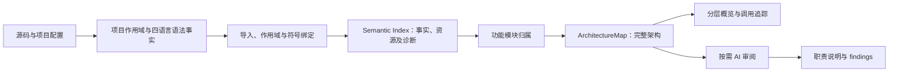

# FlowWeave 静态分析与架构画布

当前链路采用 Semantic Index v5（生成规则 5.0.1）、ArchitectureMap v3（生成规则 3.0.1、聚合规则 5、审阅输入契约 3）与 Canvas v6。实现及验收状态见[验收记录](plans/2026-09-23-static-architecture-graph-refactor-progress.md)，逐条事实、诊断及真实项目检查见[验收证据](plans/static-analysis-v5-validation.json)。模块数量、单文件比例和依赖边比例是观察数据；完成标准是关系可解释、证据可定位、归属可理解、用户数据可恢复。

## 1. 主链与运行边界



项目打开、恢复、重扫、IPC 和 CLI 共用 `registerGenerationRequest()` → `buildSemanticIndex()` → `buildStaticArchitecture()` → `writeBatchAtomic()`。请求先登记唯一 ID，最近登记的请求拥有提交权；分析使用同一源码、配置和解析依赖快照，提交前再次核验文件集合及快照。语义索引只准备写入内容，不自行持久化；项目、索引、架构、Canvas、任务、文件树、确认基线和缓存以同一生成身份在项目锁内提交，`generation.json` 最后替换。跨进程项目锁使用原子文件创建；崩溃恢复读取持久事务日志。新请求失败时旧的已提交架构保持有效，较早请求不再补交。

旧 Canvas v5 先恢复显示，再尝试扫描。它可平移、搜索、展开、查看证据和导出；编辑、自动保存、发送、确认及 AI 采纳在旧图模式下关闭。重扫失败时旧图保留并显示原因，只有成功提交后才恢复编辑。应用运行不要求 Python、Go 或 JDK；TypeScript 与 Tree-sitter WASM 是应用内运行资源。

先发现作用域和配置，再绑定符号。禁止用全项目同名搜索或文件扫描顺序直接生成调用边。“已定位”仅表示静态引用目标可确定；不能据此声称执行过代码、观察到请求或确定运行时调用顺序。

TypeScript JavaScript 实现及 `lib/*.d.ts` 标准库声明均纳入安装包；打包器默认排除声明文件，因此标准库使用明确的文件映射包含。缺失默认标准库声明抛出 `TypeScriptRuntimeAssetError`。WASM 初始化或语言资源失败抛出 `TreeSitterInitializationError`。这些故障不能退回正则并继续声称解析成功。

## 2. 配置与四语言绑定

发现依据是扫描文件清单；嵌套包、工作区、应用和配置共同建立 `AnalysisScope`、源码根及包索引。TS 配置使用 TypeScript 自身的格式和继承解析；pnpm YAML、Python TOML、Maven XML 使用应用内受限静态读取器，不增加运行依赖。读取后校验结构；XML 禁用实体处理并拒绝 DOCTYPE/ENTITY 声明。

| 语言 | 已实现的确定性绑定 | 能力边界与诊断 |
|---|---|---|
| TS/JS | 全扫描包索引、嵌套配置继承与项目引用、路径别名、exports 条件和子路径、ESM/CJS、字面量动态导入、重导出、调用与 JSX 渲染 | 非字面量动态导入、类型导入被用于运行调用、仅有声明而无实现、符号未定位分别诊断。 |
| Python | 普通及明确 src 包布局、相对/绝对导入、别名、`__init__.py` 重导出、直接导入函数、模块限定调用、明确构造类型成员、局部遮蔽及分支顺序块 | 动态属性、动态导入、sys.path 修改及无法展开的星号导入不生成确定目标。分支合流保留候选；后续明确无条件赋值可重建唯一接收者。仅文件名后缀匹配不能证明包归属。 |
| Java | 包、限定类型及静态导入、项目内继承、构造、静态方法、明确接收者类型的成员引用 | 无法唯一选择的重载保留候选。虚方法绑定声明成员并标记运行时覆盖不确定；接口分派不能认定唯一实现。 |
| Go | go.mod/go.work、本地 replace、包别名、包函数及明确具体接收者方法 | 接口分派、函数变量和构建约束保留歧义或条件诊断；条件文件不按扫描顺序选择。 |

Python、Java、Go 的事实、词法作用域、声明和接收者通过现有 WASM 语法树提取，项目级绑定由单一职责函数完成，不增加解析插件框架。不实现完整类型推导或跨函数数据流。

TS 内部包按所属配置和真实 exports 解析，不增加统一的“包名/* → src/*”后门。导出指向未构建 dist 时，只接受唯一且存在的 rootDir/outDir、项目引用或声明映射，并保留依据；零候选报告缺失，多候选报告歧义，不选首项；`.d.ts` 引用本身不能证明源码实现调用。配置损坏使生成失败，不改用另一配置掩盖问题。继承配置包括任意文件名的本地基配置和依赖包配置，均进入配置指纹；macOS `/var` 与 `/private/var` 使用可验证的实际根路径判断作用域。

Python 明确包布局来自 pyproject.toml；动态 setup.py 只报告限制。Maven XML 读取静态模块、源码根及项目内依赖；Gradle 只读取可识别字面量配置，动态表达式不执行。为避免新增运行依赖，pnpm YAML、Python TOML 和 Maven XML 由应用内受限静态读取器解析；YAML 只接受静态字符串包列表，TOML 处理常用标量、数组、内联表、数组表和多行字符串，XML 拒绝 DTD/实体声明。超出支持语法或损坏的关键配置明确报错，不执行配置脚本，也不假装成功解析。

## 3. 事实、资源和证据

`StructureSymbol` 保存稳定符号身份、限定名、作用域和声明范围。`SemanticRelation` 保存来源范围、结构化目标、绑定依据、导入用途及操作类型。`SemanticTarget` 区分文件/符号、资源、外部模块及带原因/候选的未定位目标。调用位置与目标声明位置独立存储。

位置统一为一基行列、UTF-16 列、结束位置不包含字符。中文和代理对字符纳入四语言夹具检查。同文件指向同目标的多处调用保留不同事实 ID；聚合边保存全部事实 ID 和证据，不能因去重丢失位置。

| 事实 | 架构关系 | 聚合仍保留的信息 |
|---|---|---|
| 导入、类型引用、继承 | depends_on | 值/类型导入用途、继承 |
| 函数调用、组件渲染 | calls | call/render、静态目标绑定依据 |
| HTTP 请求 | external_api；只有可证明服务映射时才匹配内部调用 | HTTP 方法、来源、规范化路径 |
| 文件、数据库行为 | reads_writes | 读/写、资源身份 |
| 事件 | publishes_event / subscribes_event | emitter/通道身份、事件名和方向 |
| 明确进程启动 | calls | 进程操作和命令资源 |
| 测试调用 | tests | 测试来源，排除生产调用覆盖 |

取消所有事实必须具有 targetFile 的限制。操作识别先验证导入 API 或接收者身份；自定义同名 fetch、db、query、emit 或 repository 不能凭名称变成外部行为。

资源身份规则：

- HTTP 使用来源、方法和路径；查询参数值及 URL 凭证不进入 ID。相对端点缺少来源时限定在当前作用域并降低置信度。同路径/方法但不同服务不能自动匹配；内部 HTTP 必须有同服务或相同已知来源且目标唯一。
- Axios 先遵循静态可证明的 `baseURL` 与 `allowAbsoluteUrls`，再规范化最终身份。协议相对 URL（如 `//service.test/users`）不继承另一服务的主机；运行协议无法证明时保留诊断，不生成已确认 API。
- 数据库使用可定位接收者/数据源及字面量单表 SQL 或已验证模型；连接工厂不是查询。SQLite `prepare()` 只保存 SQL 和数据源身份，只有 `all/get/run/execute` 等执行点生成读写事实，参数不能补成 SQL。复杂 SQL、动态 SQL和复杂 ORM 保留能力限制，不以 query 函数名替代表名。
- 文件仅在路径基准能够证明时生成资源。当前规则支持字面量绝对路径；复制同时保留来源读取和目标写入，重命名保留来源与目标角色，`open/openSync` 按静态模式判断读写，数字标志中的 `O_CREAT`/`O_TRUNC` 记入写入方向；相对路径或动态模式缺少可证明依据时保留操作与原因，不假定扫描根等于运行 cwd。
- 事件以 emitter/通道身份和事件名标识。同一实例的直接别名、导入和重导出沿用身份；不同实例保持独立，无法建立稳定唯一声明 anchor 时报告歧义。同名不同通道保持独立。资源只在完整架构中创建一次，画布投影不再重复生成事件节点。
- 进程以明确命令及作用域标识；命令构造与启动区分。
- 外部依赖、标准库和未定位内部包分别处理。源码不可用的外部库不计作内部包失败；缺少资源身份时保留未定位事实，不创建“未知数据库”等节点。

每条事实恰有一个处理结果：架构边、模块内部、外部/资源、歧义、未定位或不支持。质量摘要按事实类别列出数量和事实 ID，可展开到原始来源。聚合依然保留 read/write、call/render 等细分语义。

## 4. 功能模块与展示分组

功能归属和架构层/技术栈分别保存。归属顺序固定：包/应用/具名服务 → features/modules/domains 等明确功能边界 → 同一边界内稳定职责目录或名称 → 有调用/渲染证据且归属唯一的辅助文件 → 带原因的独立文件。

包和应用边界先分开，再执行现有职责聚合规则。共享契约不能因唯一调用者被入口吞并；类型导入不作为合并依据；导入只能辅助解释归属。命名辅助文件须具有匹配职责及唯一真实调用/渲染邻居。多个合理候选保持独立，不按权重或扫描顺序强选。测试按所属包、功能和测试目录归组，测试角色单独记录，不创建全项目 Tests 模块。

模块 ID 由稳定作用域和职责 anchor 生成，标题和行号不参与。保留前驱、拆分、合并及归属歧义诊断，用于安全迁移。单文件模块允许存在，不为降低比例强行合并。

Canvas v6 保存完整模块、资源及关系。真实 `ArchitectureGroup` 是独立投影元数据，折叠卡片显示组名、模块数、文件数，不能用第一条模块假装组。多包项目先显示包/应用组；单顶层包直接展开到功能模块。资源归入单独展示组并保持可查看，不参与源码模块计数。

新项目一律以 Architecture 概览打开。已有项目保留视图偏好。聚合连线显示关系类别和数量，并提供原始关系及源码证据；聚合组和资源只读，资源不参与文件修改任务。展开聚焦组，搜索命中隐藏模块时展开祖先组并定位。上游/下游追踪基于完整图，再映射到显示卡片。

折叠、展开、筛选和布局只改变投影，不改事实拓扑。运行流程区分生产、测试及“依赖覆盖层”，边的置信度独立显示。保留紧凑 SCC/支持模块网格布局、滚轮平移和缩放范围；ELK 原生分区允许真实反向依赖和循环，不生成相邻层的两两虚拟约束边。

未连接模块说明实际原因：只有依赖、关系位于模块内部、目标未定位、未发现跨模块关系或显示设置隐藏。旧生成图缺失新诊断时标记旧版本/未提供，不能补造原因。质量面板显示解析、内部导入、调用定位及事实处理情况；“文件归属覆盖”和“证据引用有效性”只表示各自检查范围，不能等同完整分析程度。

## 5. 缓存、失败与持久化

Semantic Index v5 不复用旧版本语法/链接缓存。源码内容哈希、配置内容、继承链、源码根、包索引、类型解析读取的声明文件、目录存在性/枚举结果及各生成规则版本进入共同输入指纹。源码内容即使大小和 mtime 未变化也会使缓存失效。文件事实仍按文件缓存；完整输入指纹完全相同才复用整份项目绑定。任一源码、配置、声明文件或解析探测变化都会重建项目绑定，不存在部分文件的局部链接缓存。

单文件语法错误、超限或不支持语法保留状态、范围及具体原因；项目报告分析不完整，失败文件不提供确定调用目标。解析器资源加载失败、关键配置损坏和持久化失败使生成失败并保留可用旧架构。

索引、缓存、清单在现有工件锁内批量原子写入；架构、Canvas、任务从共同输入生成并校验扫描与架构指纹。事务日志保存暂存文件和备份； staging 全部结束才开始替换，回滚尝试恢复全部目标，生成提交标记最后替换。清理失败保留已提交结果并报告延迟清理，不误报回滚。质量无效或任一写入失败不能标记为有效新结果，避免混用不同输入版本。`architecture-local.json` 是机器生成基线，`architecture-map.json` 可以是同指纹已审阅图；只有成功重扫才切换到新架构。

## 6. 用户数据与审阅

读取旧实际生成基线，再与旧 Canvas 比较机器文案和用户覆盖。一对一身份保留用户标题、描述、指导、风险覆盖及人工位置；自动分析字段从新图取得，不能恢复过期证据。拆分/合并无法唯一对应时文案进入 orphanedNodeEdits；手工边没有可靠端点则进入 orphanedEdges，不能附到任意新模块。孤儿内容通过保存、恢复及快照继续保留。

发送确认基线与生成基线分开迁移。旧确认字段通过可证明身份映射，不以当前 Canvas 替代确认状态；待发送指导保持待发送。只有显式发送确认可消除差异。新拓扑使自动布局和 AI 审阅过期，人工位置按稳定身份迁移。

AI 按需增强职责、问题及 findings。输入包含资源、绑定依据、证据范围及能力限制；输出沿用职责增强和 findings 契约，不改事实拓扑，不增加分组采纳工作流。资源预算使用现有提示词限制。架构工件状态与审阅状态独立：AI 或序列图审阅失败仍保留当前有效静态图及错误/重试操作。

旧 Architecture v2 和 Canvas v5/v6 可读。Canvas 保持 v6，以可选字段添加分组、质量、资源、细分语义和待处理编辑；缺失语义显示未提供。IPC/CLI 返回资源、分组和质量摘要，项目状态、序列图及恢复使用同一主链。序列图顺序是静态呈现，不能解释为已观测运行时序。

## 7. 验收

采用真实四语言源码、TypeScript 和 WASM，不以模拟解析器或“至少一条线”代替绑定检查。夹具覆盖嵌套工作区、exports/dist 映射、重导出、别名、类型导入、重复调用、遮蔽、重复包名、接口/重载/构建约束、动态行为、自定义同名 API、HTTP 服务与事件通道歧义、Unicode 范围和重复扫描稳定性。

迁移检查覆盖文案、指导、风险、人工坐标、手工/孤儿边及待发送确认；配置损坏、无效质量和写入错误不能丢失旧图。分组转换验证事实 ID 和证据守恒，原始输入不被修改。配置和规则变化使索引、聚合和审阅失效。

真实项目验收在 FlowWeave 与 Understand Anything 的隔离副本完成；输出全部内部包导入的目标或具体失败原因、操作去向、代表性源码调用及原生 ELK 布局。缺失依赖配置首先验证明确失败和旧图保留；需要补齐时仅在副本提供项目锁定版本的静态配置，不改变用户项目，不执行依赖脚本。

发布前运行：

```bash
npm test
npm run typecheck
npm run build
npm run smoke:graph
npm run benchmark
git diff --check
```

mac-arm64 使用本地 Electron 构建，并通过 FLOWWEAVE_PACKAGED_EXECUTABLE 运行相同烟雾测试。隔离用户数据和空 PATH 下，检查四语言指定跨文件调用、真实资源关系、首次概览、展开后每条规范连线的 SVG 路径、箭头及端点；真实项目副本另验证首次打开和恢复。Windows 未实机验收时明确记作未验收。所有代码保持未提交，保留工作区已有改动。

## 8. GitHub 参考与技术决策

继续修现有分析链，避免并行维护两套生产分析结果。以下项目用于参考，不将社区划分直接解释成业务模块，也不引入完整框架分析平台：

- dependency-cruiser 的[导出条件与解析选项](https://github.com/sverweij/dependency-cruiser/blob/main/doc/options-reference.md#enhancedresolveoptions)、[解析失败标记](https://github.com/sverweij/dependency-cruiser/blob/main/src/extract/resolve/resolve-cjs.mjs)，[MIT 许可](https://github.com/sverweij/dependency-cruiser/blob/main/LICENSE)。
- Understand Anything 的[关系及资源类型](https://github.com/Egonex-AI/Understand-Anything/blob/main/understand-anything-plugin/packages/core/src/schema.ts)，[MIT 许可](https://github.com/Egonex-AI/Understand-Anything/blob/main/LICENSE)。
- Tree-sitter 的 WASM 语法事实能力，[MIT 许可](https://github.com/tree-sitter/tree-sitter/blob/master/LICENSE)；项目级绑定由 FlowWeave 实现。
- Graphology Louvain 的[带权社区划分](https://github.com/graphology/graphology/tree/master/src/communities-louvain)，[MIT 许可](https://github.com/graphology/graphology/blob/master/src/communities-louvain/package.json)；此次未接入。

配置解析没有新增运行依赖。YAML、TOML、XML 只接受静态读取器支持的结构；超出范围或损坏的关键配置明确报错，不执行被扫描项目代码。
