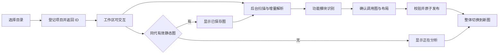

# FlowWeave 静态加载与功能模块图整改计划

> 历史计划与实施记录。当前整改范围、全版本迁移和发布门槛以[统一结构和全版本迁移深化设计](STATIC_LOADING_MODULE_GRAPH_DEEP_DESIGN.md)为准；本文件保留供需求与既有工作追溯。

状态：实施中；跨项目发布验收仍未完成  
范围：新项目首次静态分析、功能模块识别、模块调用图、默认布局、相关画布控件及旧数据迁移  
适用对象：受支持语言的单仓库、单包及多包项目；项目类型和规模不预设为某一个样本

## 1. 决策与边界

在现有 FlowWeave 上调整，不另起一套应用。保留已经具备价值的项目扫描、语言解析、语义事实、证据定位和原子写入；重做阻塞式打开流程、功能模块归属、默认图投影及布局。规则应依赖可验证的结构与语义事实，不以某个项目的目录、技术栈或业务名称为蓝本。旧分析产物属于可重建数据，应从源码事实重新生成；用户手动位置、标注和其他不可重建数据必须迁移或保留待处理记录。

用户已接受：全新项目先立即进入工作区，明确显示“正在分析”；准确的首次模块图生成且校验完成后再整体显示。项目打开速度与完整图生成速度分别测量。任务、文档、Agent 审查等其他功能仅做兼容性回归，本阶段不重做其业务流程。

### 1.1 对话要求与交付约束

| 用户要求 | 必须交付的行为 | 不算完成的情形 |
| --- | --- | --- |
| 新项目快速打开并加载静态模块图 | 工作区快速可交互，完整静态图满足预先冻结的分层时间预算 | 只缩短加载动画或窗口出现时间，图仍长期不可用 |
| 按具体功能识别模块 | 默认图能看到具体职责名称，文件/符号归属和关系证据可追溯 | 只有“前端、后端、业务层”等大类，或只是给目录换名称 |
| 准确展示调用 | 静态目标解析、证据与未知状态明确，精确率和召回率同时验收 | 把导入当调用，或大量隐藏困难样本以提高精确率 |
| 紧凑、整齐、有规律 | 真实模块可读、对齐、无重叠，拓扑稳定时布局稳定 | 缩小到无法阅读，或全部折叠成几个大框以减少面积 |
| 在现有基础上迁移与精简 | 复用有效能力、单一新生成路径、用户数据和引用完整迁移 | 新旧生成器长期并存，或保留两套互相覆盖的状态 |
| 适用于多类项目 | 规则不含特定仓库假设，跨类型留出样本达标 | 为一个案例定制目录名、模块数量和布局顺序 |
| 控件精简且功能明确 | 视图、筛选、布局各司其职，分类信息保留可达入口 | 仅隐藏按钮，内部仍保留互相矛盾的过滤与重排状态 |

本阶段首图完全使用本地静态分析，不依赖 LLM、网络服务、Agent 就绪状态或外部项目执行；不执行被分析项目的安装、构建或启动脚本。首次完成时间不能包含等待 Agent 恢复或生成其他业务产物的时间。

## 2. 已确认的问题与待测问题

当前 `openProject` 等待 `scanAndPersistProject` 返回，而生成过程先扫描、建立语义索引、构建架构、再次扫描并写入产物；这直接阻塞“进入项目”。相关入口见 [`project.ipc.ts`](../src/main/ipc/project.ipc.ts) 和 [`project-generation.service.ts`](../src/main/services/project-generation.service.ts)。恢复已有项目虽可先读取保存状态，随后仍触发重扫。

可从代码确认的共性机制是：默认架构图可同时纳入资源节点、依赖线和调用线；聚类包含多组路径、文件名及专门目录规则；缺少有效保存坐标时，画布打开后计算布局。此前的 `ArtifactGenerationMismatchError` 提示需要核查同代快照与读取时序，但单凭该错误不能断定磁盘产物曾被混写。这些机制在不同项目上的影响程度需要测量。

这些事实不足以证明语义解析是主要耗时。实施前必须测量从目录选择、IPC 返回、解析、聚类、图投影、布局、写盘到画布可操作的端到端耗时，不凭局部扫描或 ELK 测试推断整体瓶颈。

另有两条已确认的首图附带工作：`prepareFlowWeaveProject` 同时准备任务 Markdown/JSON 与上下文文件；`scanAndPersistProject` 在特定审查状态下恢复架构及序列图 Agent 审查。整改应将这些工作与静态首图完成条件解耦，保留其他功能按需读取同代快照的能力，不以全局删除其他功能代替解耦。

## 3. 适用边界、目标与验收口径

当前代码明确建模 TypeScript、Python、Java、Go 分析范围；其他语言或无法解析的文件必须报告为不支持或失败，不能生成一张貌似完整的“准确图”。对受支持语言，也要按语法、配置和框架集成情况报告实际解析覆盖。静态分析无法普遍确定反射、动态注入、运行时注册及间接调用的真实目标；设计目标是**在可确认范围内准确、可解释，并明确显示未知部分**，不是声称恢复任意项目的完整运行时调用图。

验收使用项目集合而非单一基准。矩阵至少横跨：单包/多包、应用/库/CLI/任务或数据处理、单语言/混合语言、小/中/大规模、显式功能目录/非显式目录、稀疏/密集/循环关系，以及冷开/热开/源码变更。每类使用真实项目与针对边界条件的最小项目，记录有效源码文件数、总字节数、语言、包数、关系数、存储介质和机器配置。已讨论的项目只占其中一个回归样本。

| 目标 | 验收方法 | 发布约束 |
| --- | --- | --- |
| 首次进入项目 | 各规模与项目类型分别记录目录选择结束至工作区可交互的 p50/p95 | 以约 1 秒为交互目标；不等待完整分析，超标样本逐项定位 |
| 首次完整图 | 按规模、语言与冷缓存状态分别记录 p50/p95，并与改动前同条件比较 | M0 实测后为各规模等级确定时间预算；不得用单一项目的 5 秒目标替代全体 |
| 有效缓存开图 | 各项目类型测量读取、校验与首次绘制 | 仅展示生成标记匹配的完整快照；性能不得比旧路径退化 |
| 文件与符号归属 | 各语言与项目类型分别核对覆盖、唯一性和未归类原因 | 文件级方案文件唯一归属；明确启用符号级归属时声明符号唯一归属、文件可多模块引用；不得重复计算调用 |
| 调用准确性 | 分层人工标注确认调用、误报与漏报，并记录解析覆盖 | 默认调用线均有可定位源码证据；精确率和可确认调用的召回率均设发布门槛 |
| 模块可理解性 | 不同项目类型的评审者独立评价名称、职责和文件归属 | 每类结果单独达标，不用一个大项目的平均分掩盖弱项 |
| 图面质量 | 对稀疏、密集、循环及无边图做位置和截图检查 | 默认图无重叠、无原点堆叠；相同输入产生相同排列 |
| 一致性 | 并发打开、重扫、源码中途变化和恢复旧项目的集成测试 | 不显示混代图，不丢失用户编辑 |

精确率、召回率、模块评审分数与图完成时限的具体阈值由 M0 在测试矩阵上建立基线后确定，并逐类公布，不能反过来挑选样本满足预设数字。模块数量没有固定上限目标；首屏采用层级聚合控制密度。

### 3.1 防止验收空泛

M0 必须产出并冻结一份验收表：支持能力列表、样本与留出样本、源码范围、机器配置、规模分层边界、每类完整图时间上限、质量门槛及测量次数。表中存在待定项时，不能宣称重构已经具备发布条件；门槛不得在看到留出结果后下调来迁就实现。当前不编造没有测量依据的全项目统一秒数。

时间以目录选择完成为起点，分别记录“工作区可交互”和“真实模块图完成布局且可点击”为终点；冷开明确区分无 FlowWeave 缓存与操作系统文件缓存，热开和增量更新单独统计。每个发布验收场景至少重复 20 次，公布原始数据、p50/p95 和最大值；小样本 p95 仅作工程判定，不宣称统计置信区间。另记录峰值内存、首屏载荷字节数、渲染长任务及取消耗时，避免以耗尽内存换取时间。

精确率按正确预测调用数/预测调用数计算；召回率按检出的已标注、在支持范围内可静态解析调用数/该类真实调用数计算，标注样本必须包含未画出的调用。另报告全部调用点、未定位和不支持数量，防止缩小分母。模块评审采用职责一致性、名称区分度、成员合理性、碎片化/过度合并四项标准；分歧保留记录，不把人工意见包装为绝对真值。确定性解析与迁移测试中的已知错误、数据丢失和混代显示必须为零。

## 4. 静态模块识别重设计

### 4.1 两级概念

**功能区**是首屏的聚合与导航单位，其含义是项目中的可识别职责边界，而不是固定的“前端、API、业务、数据”层表。Web 应用可能按用户功能或服务边界分区；库可能按公开 API 与内部子系统分区；CLI 可能按命令分区；任务或数据项目可能按输入、处理与输出职责分区。这些只是可能的结构，实际名称和数量必须有项目证据；找不到足够证据时使用中性的包或目录边界并说明依据，不编造业务概念。

**功能模块**是共同完成一项可描述职责的源文件集合，可以跨相邻目录；跨包或跨语言的协作通常体现为功能区与模块之间的连接，而不是无证据地合并源文件。模块记录稳定 ID、显示名、职责、所属功能区、成员文件、入口符号、分类依据及置信度。目录不是天然模块，单个文件也不因文件名独特而自动成为模块。

“API、基础支撑”描述职责类型，“用户管理、任务调度”等描述具体功能，两者不得混为同一分类。职责类型作为模块标签；具体功能决定名称与归属。缺少业务语义时保留中性名称并标注“结构边界/待判定”，不把包名推断升级为确认的功能结论。

### 4.2 判定顺序与冲突处理

1. **边界识别**：复用已有 `AnalysisScope`、工作区包、源代码根目录、可确认入口和已解析文件集合；区分业务源码、生成文件、依赖、测试与不支持文件。边界可成为功能区，但不会自动等同功能模块。
2. **显式职责种子**：按项目类型识别公开 API、命令、服务处理器、页面、作业、数据管道阶段等可确认入口，以及明确声明的功能分区。`features`、`domains` 等目录只作加权线索，不是跨项目硬编码规则；泛目录、后缀和自然语言名称的权重更低。
3. **证据聚合**：在分析范围内使用已解析的调用、导出、注册及文件引用，为种子吸收实现文件；跨包关系保留独立模块并建立连接。仅由文件名相似或调用密度推导的归属必须标记为低置信度。
4. **支撑文件归属**：只服务于一个模块的 helper、类型和配置归入该模块；被多个模块复用的保留为共享支撑。无法唯一判断时记录候选与理由，不随机附着。
5. **命名**：优先使用显式功能入口或功能目录名称，次选核心导出符号；禁止“某目录的业务逻辑”这类不可区分描述。新名称须能追溯到源码证据。
6. **身份稳定**：ID 基于包边界与功能锚点；成员微调不改变 ID。拆分、合并时记录旧新对应关系，供用户编辑数据迁移使用。

先在跨类型样本上人工标注候选功能区和模块，再实现与调参；保留独立于实现项目的留出样本用于验收，防止规则为已知仓库过拟合。保留可诊断的“待归类”，不把不确定性藏进“基础设施”大桶。若某类项目的职责边界客观上无法从静态事实唯一推断，允许用户校正模块归属并持久化该明确决定，但基础体验不得依赖人工配置才能打开。

实现顺序固定为“源码事实 → 文件/符号关系 → 候选归属 → 模块图投影”，模块命名和布局不能反过来制造调用事实。候选归属优先采用显式声明，再采用唯一、可解释的关联；同级证据冲突时保留待判定，不任意打分选一个。合并需要共同职责证据，拆分需要独立入口、公开边界或独立职责证据；文件数量和图面大小都不能单独触发拆分或合并。

基础实现保留文件级唯一归属以控制改动规模，但单文件包含多个独立职责时必须标为“混合职责”，保留符号详情，不能声称已经完成细粒度功能划分。M0 需要覆盖这一类项目；若文件级方案无法达到该类既定质量门槛，则该类发布前补齐基于已有符号范围的归属：每个声明符号唯一归属、同一文件可被多个模块引用，边按调用符号投影。不得静默排除此类项目来宣称普适性。

### 4.3 关系语义

默认功能图只展示**已确认且可定位源码位置的跨模块调用**。每条线具有调用方、被调用方、源文件与位置、底层关系 ID；同一模块对的多次调用聚合成一条可展开的线。`import`、继承、测试、数据读写、事件和外部资源引用保留各自类型，但不冒充 `calls`。无法静态确定目标的调用展示未解析数量与来源诊断，不画成确定线。某些库或声明式项目没有可确认的跨模块调用时，仍显示模块和“未发现可确认调用”的说明，并提供依赖视图，不能把空图误称为分析失败。

这意味着新图可能比旧图少线。验收同时检查**精确率和覆盖率**：少画错线是必要的，但不能用过滤全部复杂调用来制造“准确”。

“确认”指在当前源码快照和解析配置下调用表达式的目标可以唯一解析，不等于证明运行时一定执行。跨语言或跨进程关系只有双方契约及绑定证据足够时才能建立对应类型的关系；同名函数、相似 URL、发布与订阅使用相似字符串均不能自动转换为直接函数调用。用户手工连接单独保留为用户声明，不进入自动确认调用指标。

## 5. 首次打开与一致性流程



`openProject` 只等待目录登记及最小项目元信息；后台分析独立报告发现、解析、归属、关系、布局、保存阶段。CPU 密集工作不得阻塞渲染交互。复用现有语义索引及按文件内容的增量结果；配置或分析器版本变化时按依赖使相关结果失效。不要为首屏再读取和解析完整 Canvas 的大体积详情；提供与提交代际绑定的轻量首屏快照，详情按需读取。实现时先检查现有 Canvas/architecture 产物能否拆出这一投影，避免长期并存两个事实来源。项目过大时进度必须显示已分析与待分析范围；首版完整图仅在约定的支持范围分析结束后发布，不把局部结果伪装为全项目结论。

一次生成固定 `requestId`、源码指纹与生成器版本。项目源码在生成期间变化，或新请求取代旧请求时，旧结果不能发布或更新当前界面。模块、调用证据、布局及提交标记先校验，再利用现有批量原子写入发布。渲染器按一个提交标记读取整份快照；`generation` 不匹配时显示具体的“分析结果已变化，正在刷新/需重试”，而非“文件不存在或权限不足”。旧图若仍可见，明确标记为上一次结果，不称其为当前准确图。

### 5.1 执行、失效与失败状态

将 CPU 密集解析与布局放入现有可复用的后台执行单元；若当前分支尚无隔离机制，优先采用 Electron/Node 已具备的进程或 Worker 能力，不新增调度平台。仅把同步工作包成 Promise 不算后台隔离。每项目同一时刻只允许一个可发布任务，重复同输入请求合并；新输入取代旧任务时实际取消或终止旧计算，限制并发和内存，不能只丢弃旧结果而让它继续耗尽 CPU。取消、关闭项目及切换项目均有集成测试。

增量失效包含文件新增/删除/重命名、内容变化、解析配置、包导出和依赖绑定、规则版本；受影响的反向依赖重新绑定。源码内容指纹决定正确性，mtime/size 只作快速检查线索。同代有效缓存不等于当前源码未变化：打开时可以显示“上次分析结果”，后台完成输入核对后才能称为当前；输入完全相同则不重做聚类、布局和完整写盘。

状态至少包含分析中、成功、完成但覆盖不全、失败、已取消、被新请求取代。解析失败、不支持、忽略项分别计数；出现缺失文件时不能无提示省略。覆盖不全的结果须明确注明范围，不能作为“完整准确图”通过验收。失败界面显示阶段、文件或配置定位及可执行操作，保留有效历史数据；不无限自动重试，不静默降级为目录图。新项目没有有效图时继续显示失败/覆盖说明，不显示伪成功画布。

### 5.2 最小数据契约与首屏链路

| 数据 | 最少内容 | 约束 |
| --- | --- | --- |
| 提交快照 | 项目身份、代际 ID、输入指纹、分析与结构版本、覆盖摘要 | 唯一已提交事实版本；读取时不拼接不同代文件 |
| 功能模块 | 稳定 ID、名称、职责类型、功能区、归属依据、文件/符号引用 | 生成事实与用户校正分别保存，校正不得篡改源码证据 |
| 调用关系 | 源/目标 ID、关系类型、来源位置与底层关系引用 | 端点有效；聚合不丢失类型和方向 |
| 首屏投影 | 节点摘要、聚合边、坐标、图与布局指纹 | 从同代事实生成；不携带完整源码和全部符号详情 |
| 视图状态 | 展开范围、筛选、视口、手动坐标 | 与分析事实分离；筛选不改模块归属，不触发重新解析 |

首屏必要事务只包含静态事实、首屏投影、坐标及安全迁移所需数据。任务文档、上下文导出、Agent 架构/序列审查改为显式使用时读取已提交快照并生成；它们的失败不能把成功的静态加载变成失败。现有消费者只读新契约或短期兼容转换结果，不再自行启动一套旧扫描写入流程。

## 6. 默认模块图与布局

默认首屏优先显示**功能区容器内的具体模块**及调用，而不是始终只画几个功能区大框。按当前视口和可读字号判断是否需要折叠：能清晰呈现的模块直接展示，超出可读范围的分区才聚合，并显示模块数和调用数；点击一次可展开，搜索具体模块时自动定位并展开其父区。首图保存默认展开状态和对应坐标。资源、测试及大量 `depends_on` 默认不挤入调用图，但项目以测试为主体时必须显示其模块并说明角色，不能得到空白项目。未发现调用的模块仍保留。

详情面板展示文件、符号、关系来源、资源与未解析诊断；依赖视图的线明确标为依赖。没有明确功能区的项目将已识别模块按包或源码范围组织，容器标为结构范围，不将其冒称为功能模块。无边图采用确定性的紧凑网格；多入口、库或不连通图不假定唯一执行起点；密集图按需展开。不为不同项目类型分别写一套布局引擎。

继续利用现有 ELK，不先引入新的布局引擎。先把调用图中的循环压缩为强连通组，再按入口与调用方向确定主要层次；同一功能区内部用紧凑网格，统一节点尺寸、间距和对齐线。跨区多次调用聚合走线；稳定 ID 决定同层次排序。拓扑未变时直接使用保存坐标，少量变化时尽量保持未受影响节点的位置。展开与筛选优先做局部投影，不应触发全项目反复布局。手动位置仍可覆盖自动布局，但与自动坐标分开保存。

紧凑性同时检查节点包围面积与留白、边交叉数、最长边、文本可读性和相同节点的位移，按拓扑类别与改前结果比较；在相同展开范围和节点尺寸下比较，不能用折叠更多节点换取虚假的提升。关系筛选只隐藏/显示边，普通节点筛选保持坐标；只有展开拓扑变化或用户“整理布局”才执行必要重排。图指纹须覆盖节点尺寸、分组、可见拓扑、布局版本与方向，避免错误复用坐标。

## 7. 画布控件审查与精简

截图中的四组下拉**有交叉，但不完全相同**。问题是“选择看什么”和“怎样摆放”被放进同一条工具栏：

| 当前控件 | 实际行为 | 重复或误导点 | 处理 |
| --- | --- | --- | --- |
| 布局：运行流程、依赖关系、架构分层、技术栈、功能模块 | 前两项改变关系投影；后三项主要改变分组/排列 | 一个控件混合图语义与布局；“架构分层”优先使用 `groupPath` 的包/目录分组，并非旁边“架构层”的同一分类 | 拆成“视图”和内部布局策略；删除五选一的“布局”下拉 |
| 技术栈：前端、后端、移动端、数据、基础设施、共享、未知 | 按模块粗粒度实现类别筛选节点 | 与“技术栈布局”用同一类标签；这些值混合了运行端和职责范围，不是框架或语言意义上的技术栈 | 移出首屏，当前标签只在详情中解释；若后续证明确需横向筛选，再基于准确元数据提供高级筛选 |
| 架构层：展示、API、业务、数据、集成、基础设施、测试、未知 | 按类别派生的职责层筛选节点 | 与“架构分层”名称相似但口径不同；现有规则把作业和共享工具归入基础设施，可能误导 | 首屏移除；作为模块详情中的“职责类型”，待新识别规则验证后再决定是否提供高级筛选 |
| 关系：依赖、调用、读写、外部 API、事件、测试等 | 在当前视图剩余的线中再做单选筛选 | 与“运行流程／依赖关系”先投影后过滤，可能组合出空图；“全部”在不同视图含义不同 | 默认功能图固定为“确认调用”；其他关系移入“关系显示”菜单，按类型复选并标明含义；依赖保留独立视图 |

代码证据：[`CanvasWorkspace.tsx`](../src/components/CanvasWorkspace.tsx) 中 `layoutMode` 同时驱动图投影、分组、布局和坐标读取；`relationFilter` 在投影之后再次过滤。[`graph-converters.ts`](../src/utils/graph-converters.ts) 的架构分组优先读取 `groupPath`，而 [`canvas-layout.ts`](../src/utils/canvas-layout.ts) 和 [`canvas-filters.ts`](../src/utils/canvas-filters.ts) 使用架构层、运行端进行排列或筛选。这不是四个名称简单重命名能解决的问题。

### 7.1 建议的新工具栏

常驻：**搜索模块或文件｜视图：功能调用图 / 依赖图｜折叠或展开｜整理布局｜筛选**。

“功能调用图”是默认且唯一承担首屏性能目标的视图；“依赖图”供排查导入和资源边界，不作为默认图。“整理布局”只重排当前视图，不更改节点或关系的语义。恢复手动布局放进布局按钮的次级菜单，不再占一个常驻按钮。筛选面板先提供“功能区”；“关系显示”按视图列出适用类型，默认图的“调用”不能被“全部”含糊替代。只显示项目中实际出现的可选值与命中数；无命中时说明是视图、折叠还是筛选造成，不把它解释为“项目没有关系”。

第一阶段不增设新的同级下拉。若使用研究证明用户需要按职责类型横向比较多个模块，再增加高级筛选，而不是恢复“架构层”常驻控件。

能力不是直接删除：确认调用默认开启；数据读写、外部 API、发布/订阅及测试关系由“筛选”内的“关系显示”复选项控制，各自保留类型、方向和图例，需要的资源端点按需加入。依赖图默认显示依赖，调用作为可选叠加；菜单只列当前快照支持的类型，禁止先被视图移除再提供一个无效筛选。筛选采用组内并集、组间交集，显示生效条件及“重置”；折叠是信息粒度，不与筛选混用。键盘、焦点、按钮名称和窄窗口可用性纳入控件验收。

### 7.2 旧视图状态迁移

旧 `architecture`、`domain`、`technology` 布局偏好迁移到“功能调用图”；旧 `execution` 迁移到该视图，并在需要时保留其非调用关系偏好为次级显示选项；旧 `dependency` 迁移到“依赖图”。这些映射只迁移用户的**查看偏好**，不能把旧图的推断关系升级成确认调用。当前技术栈、架构层和关系筛选仅为组件局部状态，不需要持久化迁移。手动坐标须按新旧模块映射谨慎迁移。

## 8. 旧数据迁移与退役

| 数据 | 处理 |
| --- | --- |
| 项目登记与源码 | 原样保留；不修改被分析项目的业务代码 |
| 语义索引、已定位事实 | 验证版本与输入指纹后复用；失效部分重算 |
| 旧模块、名称、依赖/资源线 | 视为可重建派生判断，从源码事实生成新模型；不原样复制进默认图 |
| 用户手动位置、标注、连接及其他编辑 | 依据包边界、成员文件和符号建立旧新映射；一对一且证据充分才自动转移 |
| 拆分、合并或消失的旧模块 | 保留原编辑及候选映射供审阅；不静默丢失，也不任意分配 |
| 旧 Canvas 与架构文件 | 新快照提交并通过校验前不删除；保留过渡读取器和可恢复副本，稳定后清理重复生成路径 |

迁移过程在后台运行，不阻塞进入项目。新旧结果切换必须原子完成；迁移失败时保留旧用户数据与明确错误，允许重新执行。发布前对已有项目做一次迁移演练，逐项核对节点数、用户编辑数和待人工处理数。

迁移不仅针对 Canvas：盘点任务、上下文、修改基线、序列结果、审查数据和导出中所有模块 ID/边 ID 引用。可唯一映射的引用转换；不能唯一映射的用户内容保留并标记待处理；派生结果标记失效后按需重建，不假称为当前。用户手工连接、模块校正和已保存坐标均列入迁移清单。未知旧版本报明版本与升级要求，不以空模型覆盖。

迁移记录源/目标结构版本、输入身份及完成状态，可重复执行且不重复创建编辑项。中断后恢复事务或继续未完成迁移，不反复改写成功数据。仅在新结果发布、所有消费者切换和恢复演练通过后停用旧写入器；旧用户数据备份不随清理旧生成代码而删除。每个已支持的历史格式各有含用户编辑的真实文件测试。

## 9. 实施阶段与依赖

| 阶段 | 工作 | 退出条件 |
| --- | --- | --- |
| M0 测量与样本 | 建立跨语言、项目类型、规模及拓扑的测试矩阵；分段计时并人工标注模块及调用；留出独立验收样本 | 明确各类瓶颈、覆盖边界、误判类别及分层基线，确定发布阈值 |
| M1 加载与一致性基础 | 先建立单任务发布、同代读取和取消约束，再将 IPC 首入与后台生成解耦；移出 Agent/其他产物等待 | 各规模类别达到首入预算；并发切换不串项目，无混代与旧任务覆盖；离线可完成首图 |
| M2 重判模块 | 基于通用证据的功能区、模块、文件归属、命名与未归类诊断 | 各项目类型人工样本通过；留出样本无明显退化 |
| M3 首屏图 | 确认调用投影、层级聚合、稀疏/密集/无边布局、保存坐标、轻量读取 | 各语言关系精确率与覆盖门槛、各拓扑布局目标通过 |
| M4 精简控件 | 新视图/筛选/重排工具栏及旧偏好映射 | 各控件语义单一；无矛盾组合造成的误导性空图 |
| M5 全量迁移与消费者切换 | 基于 M1 一致性机制迁移用户编辑及跨产物引用，统一旧项目恢复、刷新及其他消费者 | 所有受影响消费者使用新契约；中断和重复迁移可恢复，无编辑丢失 |
| M6 清理和打包 | 删除被替代的旧默认规则，完整回归并重新打包 | 冷开、热开、准确性、迁移与跨项目测试通过 |

M0 是后续性能优先级的前提。M2 与 M3 可分别评审，但上线必须与 M4、M5 的语义及数据迁移一起完成，不留下两个相互冲突的默认图。

### 9.1 代码落点与删改范围

| 现有位置 | 计划中的职责 | 退役或移出首图的内容 |
| --- | --- | --- |
| `src/main/ipc/project.ipc.ts`、`src/hooks/useProjectActions.ts` | 打开/恢复/刷新共用轻量入口、进度和结果契约 | 等完整扫描才进入项目；在首图完成前恢复其他审查 |
| `src/main/services/project-generation.service.ts` | 单项目调度、输入核对、生成与同代发布 | 重复同输入生成、旧任务无效计算和晚到结果覆盖 |
| `src/main/services/module-clustering.service.ts`、`static-architecture.service.ts` | 通用证据归属、模块身份、关系聚合 | 为特定仓库目录定制的分组、目录名直接等同业务职责 |
| `src/main/storage/flowweave-store.ts`、`canvas-migration.service.ts` | 必要原子写入、轻量投影、版本与用户数据迁移 | 首图同步生成非必需任务/上下文；重复事实副本 |
| `src/utils/graph-view-projection.ts`、`graph-converters.ts`、`canvas-layout.ts` | 明确关系语义、适应视口的粒度、稳定布局 | 默认资源洪泛、相同拓扑重复布局和互相冲突的分组逻辑 |
| `src/components/CanvasWorkspace.tsx`、`canvas-filters.ts`、`src/types.ts` | 精简控件、单一视图状态、明确空态与覆盖信息 | 五种布局模式混合语义、多处类别推断及无效过滤组合 |

实施前枚举所有生成入口和读取消费者，包括打开、恢复、刷新、其他功能按需请求与现存启动入口。同一能力只能有一个正式实现；旧适配只用于读历史数据，迁移完成后按调用引用和测试证据删除。不得仅修首开按钮而让恢复或刷新继续走旧规则。实际工作区若已有后台隔离、概览产物或迁移改动，先检查并复用，不能依据此表重复实现。

## 10. 测试、风险与发布门槛

测试矩阵至少包含：受支持的四种语言各自的单语言项目、混合语言和多包项目；应用、库、CLI、任务或数据处理项目；小、中、大不同源码规模；显式与非显式功能分区；稀疏、密集、循环和无边拓扑；动态调用、解析失败和不支持文件。原先检查的项目只保留为一个回归样本。覆盖首次打开、有缓存打开、源码变动、连续切换项目、重复扫描、扫描中修改文件、布局重用、折叠展开、筛选和旧 Canvas 迁移。性能数据记录机器、存储、项目规模、缓存状态、p50/p95，不只报告最好一次，也不将不同规模混成一个平均值。

关键风险是静态语言分析的覆盖率：默认图减少误报的同时，可能漏掉运行时注入、反射或动态路由。必须在界面显示解析覆盖及未定位关系，允许用户追溯证据，但不让不确定关系污染确认调用图。不同语言和框架的可确认事实种类不同；某一类达标不代表另一类达标。另一个风险是旧模块拆分/合并导致编辑难以自动归属；此时保留待审阅数据优于猜测。若 M0 测量表明主要瓶颈不在默认图规模或布局，应调整实施顺序，先修真实瓶颈。

发布采用测试矩阵先演练、真实项目限量启用、最后默认启用的顺序。每一步都保留可回退的旧用户数据；旧默认生成逻辑只在新路径通过跨类型性能、正确性和迁移验收后删除。整改完成的判断依据是各类项目的首开体验、功能模块可信度和图面可读性，而不是代码删改量、下拉数量或某个仓库的单次结果。

## 11. 实施任务与完成记录

任务顺序遵循 M0 为性能与质量门槛前提的要求。每项只有在代码/文档交付和对应验证都通过后才标记完成；M6 不能替代 M0–M5 的验收。

### Task 1: M0 建立跨类型基线与留出样本

交付可重复的项目矩阵、人工标注样本、分阶段性能记录及冻结的分层门槛。至少覆盖四种支持语言、混合语言、多包、应用/库/CLI/数据处理、稀疏/密集/循环/无边图，并包含独立留出样本。每个发布验收场景重复至少 20 次；同时报告完整图准确性、覆盖率、首入 IPC 延迟、完整图 p50/p95、峰值内存及机器与磁盘信息。没有真实数据的类别必须标为未验收，不能外推。

### Task 2: M1 解耦首入、分析调度与原子发布

进入工作区的响应只依赖项目登记与最小元数据；CPU 密集分析放在可取消的后台执行单元。相同输入请求合并；切换项目、新输入、关闭项目能真实取消旧计算。非静态任务、上下文及 Agent 审查改为按需使用已提交快照。通过多项目切换、源码中途变化、同代读取、取消和离线首图集成验收。

### Task 3: M2 通用功能模块归属

使用显式入口、包边界及带置信度的语义事实识别功能区与模块；证据不足时保留中性结构分组和待判定诊断。按冻结的跨类型人工标注集与留出集核对职责、命名、成员归属、混合职责与未归类范围。

### Task 4: M3 首屏投影、调用语义与布局

默认图只投影有源码证据的已确认跨模块调用；加入轻量同代首屏快照、细节按需读取、视口适配聚合和稳定 ELK 布局。以调用精确率/召回率、覆盖诊断、不同拓扑的重叠/留白/边交叉/稳定性门槛验收。

### Task 5: M4 简化工具栏与筛选状态

完成视图、功能区筛选、关系显示、折叠和整理布局的单一语义；实现组内并集、组间交集、计数与重置，并覆盖空状态、键盘焦点、窄窗口和用户偏好兼容。

### Task 6: M5 全量迁移与消费者切换

盘点 Canvas、任务、上下文、修改基线、序列图、审查和导出中的模块/关系引用；迁移可唯一映射的用户编辑，保留待处理数据。验证历史版本、事务中断恢复、幂等重跑、备份恢复及所有消费者切换，确认零数据丢失后停用旧写入器。

### Task 7: M6 清理、回归与打包

仅在 M0–M5 验收通过后删除过渡读取/写入逻辑，运行完整测试矩阵、冷开/热开/增量/迁移回归并打包。未通过任一发布门槛时，保留失败证据并将计划状态保持为实施中。

### 11.1 当前实施与验收状态（2026-10-03）

| 阶段 | 当前结论 | 已验证内容 | 尚未满足的退出条件 |
| --- | --- | --- | --- |
| M0 测量与样本 | 部分完成 | 建立可重复的扫描、语义索引、提示构造和 ELK 微基准；每个微基准场景 20 次 | 缺少跨项目类型的人工模块/调用标注集与独立留出集；未测完整 Electron 首入到可点击首图的 p50/p95、逐场景峰值内存和首屏载荷；没有冻结各规模类别的发布预算 |
| M1 加载与一致性 | 实现及代码回归通过 | 首入与后台分析分离、后台 worker 可取消、相同扫描输入合并、生成代际和源码快照提交校验；并发新旧代提交、取消及源码变化保护已测 | 仍需在项目矩阵上测真实首入延迟、切换取消时间及完整首图时间 |
| M2 模块识别 | 实现及样例回归通过 | 通用结构证据聚类、中性模块分组与跨语言样例；不把导入直接算成调用 | 没有独立人工标注和留出项目，尚不能声明不同项目类型的模块归属、命名及调用精确率/召回率达标 |
| M3 首屏图与布局 | 实现及打包冒烟通过 | 确认调用图、布局待处理状态、ELK 布局、过滤时稳定坐标；打包版覆盖有边、空图、四语言关系及旧图恢复 | 尚无跨拓扑的截图评审、重叠/留白/边交叉/位移数据，以及真实项目端到端完成时间 |
| M4 工具栏与筛选 | 实现及 renderer 测试通过 | 视图与布局操作分离，功能区筛选不触发布局重排，关系语义按需显示；搜索、空态和重置有回归覆盖 | 仍需人工检查窄窗口、键盘焦点及辅助技术可用性 |
| M5 数据迁移与消费者 | 核心 Canvas 迁移实现；全量验收待完成 | v5/v6 Canvas 编辑、位置、关系备注及孤立改动保留有集成测试；打包版旧 v5 失败重扫不会覆盖原数据 | 历史格式和所有跨产物消费者尚未逐项演练；拆分/合并待处理项需在独立真实项目上核对 |
| M6 回归与打包 | macOS arm64 工程验证通过 | 完整测试、类型检查、生产构建、arm64 目录包、打包启动及静态图烟测均通过 | 按本计划，只有 M0–M5 发布退出条件满足后才能把最终发布门槛标为通过 |

当前四项遗留修复（保存屏障、系统评估失效、隐藏项事实身份迁移、详情缓存及 revision 校验）的代码状态、分档原始样本和未通过条件集中记录在[深化设计的验收记录](STATIC_LOADING_MODULE_GRAPH_DEEP_DESIGN.md#9-验收记录与未决事实)。M0 仍缺跨类型独立留出集、预先冻结的预算及详情 IPC/面板测量；M5 仍需真实历史数据审阅。因此本表各阶段的“实现通过”只描述对应局部代码验证，不改变整体验收结论。

本轮性能测量运行 `npm run benchmark`，共 20 次独立冷样本或 20 次热样本。机器为 macOS 26.6.2（arm64，Apple M4，16 GiB 内存）；测试时工作卷约有 204 GiB 可用空间。项目根目录均为新建临时副本，因此这里的“冷”表示无 FlowWeave 缓存，不表示清空了操作系统文件缓存。

| 场景 | 样本规模 | 次数 | p50 | p95 | 说明 |
| --- | ---: | ---: | ---: | ---: | --- |
| 目录扫描冷/热 | 1,000 个合成文件 | 20 / 20 | 23.6 / 22.8 ms | 25.1 / 23.5 ms | 仅测扫描 |
| 目录扫描冷/热 | 5,000 个合成文件 | 20 / 20 | 78.2 / 76.7 ms | 81.8 / 78.9 ms | 仅测扫描 |
| 目录扫描冷/热 | 10,000 个合成文件 | 20 / 20 | 144.3 / 143.2 ms | 146.9 / 144.2 ms | 仅测扫描 |
| TypeScript 语义索引冷/热 | 250 文件、249 条关系 | 20 / 20 | 203.3 / 11.8 ms | 230.1 / 13.3 ms | 热缓存 p50 比冷建低 94.2% |
| 扫描加语义索引冷/热 | 250 文件、249 条关系 | 20 / 20 | 218.4 / 25.0 ms | 246.0 / 29.1 ms | 尚不含模块聚类、画布投影、写入和 renderer |
| 提示构造 | 40 模块、80 条关系 | 20 | 0.4 ms | 0.5 ms | 架构审查提示 |
| ELK 分层布局 | 100 / 500 / 1,000 节点 | 每种 20 | 11 / 41.4 / 81.8 ms | 20.7 / 45.3 / 84.1 ms | 合成链图，不等于实际模块拓扑 |
| 真实项目扫描 | 282 个扫描文件 | 20 个独立进程 | 40.5 ms | 41.5 ms | OS 文件缓存未清空 |
| 真实项目语义索引 | 229 个语义文件、9,244 条事实关系 | 20 个独立进程 | 2,034.4 ms | 2,079.1 ms | 本地生成器缓存从 v5.0.1 升级到 v5.0.4，未写回项目 |
| 真实项目架构与图投影 | 164 个模块、439 条边 | 20 个独立进程 | 108.6 ms | 116.9 ms | 不含 ELK 画布布局 |
| 真实项目完整内存图链路 | 同上 | 20 个独立进程 | 2,182.9 ms | 2,229.2 ms | 最大 2,250.7 ms；不含原子写入和 renderer |
| 真实项目分析进程峰值 RSS | 同上 | 20 个独立进程 | 808 MiB | 896 MiB | 最大 900 MiB；包含进程与编译器运行时 |

上述结果证明部分计算组件已有可测性能基线，不能推导“首次打开项目秒开”或“完整图按时显示”。合成微基准不保存逐样本原始值；真实项目单样本的完整逐阶段数据保存在下文。仍未测量 Electron IPC、原子发布、ELK 实际拓扑、ReactFlow 首次可交互时间和渲染长任务，也没有独立留出集；这些数据补齐前，M0 与发布验收保持未完成。

当前代码验证（2026-10-03）：`npm test -- --reporter=dot` 为 88 个测试文件通过、734 项通过、1 项跳过；`npm run typecheck`、`npm run dist:mac:arm64`、`npm run smoke:packaged` 均通过。打包版 `npm run smoke:graph` 覆盖确认调用边、空图、四语言样例、空 PATH、并发代际提交、旧 v5 失败迁移保留、正常关闭前即时保存，以及保存失败时阻止刷新/切换和成功重试后清除旧错误；打包产物中的代际标记一致。以上仍不替代 M0–M5 的发布退出条件。

另对对话中提及的 `coregist-news_v1.0.0` 做了 20 次**只读**本地分析，每次使用独立 Node 分析进程。已有语义索引生成器版本为 5.0.1，当前实现为 5.0.4；分析只在内存生成，没有更新该项目的任何文件。结果为 282 个扫描文件、229 个语义文件、9,244 条事实关系、164 个模块、439 条图边。每次完整内存图链路（扫描、语义索引、架构聚类和图投影）p50 2,182.9 ms、p95 2,229.2 ms、最大 2,250.7 ms；独立进程峰值 RSS p50 808 MiB、p95 896 MiB、最大 900 MiB。OS 文件缓存没有清空；测量不含原子写入、ELK 画布布局、Electron IPC、renderer 绘制及可交互时刻，因此不能当作首次完整图时间。

该样本的解析文件覆盖率与证据覆盖率均为 100%，但仍有 3,512 条警告诊断：3,385 个未解析调用、48 个歧义调用、44 个未解析导入、14 个未解析资源目标、8 个未解析渲染目标、8 个未解析操作目标和 5 个未知操作目标。`quality.valid` 通过只说明确定性结构校验通过，不代表这些调用已被人工证明正确；此结果不能替代准确率/召回率评审，也不是独立留出项目。

以下为上述只读真实项目测试的原始数据。时间单位为毫秒，RSS 单位为 MiB；每组顺序均为独立进程的运行顺序：

```json
{
  "scan": [40.0, 39.5, 40.2, 40.5, 40.1, 40.4, 40.3, 40.4, 40.1, 40.6, 41.1, 40.8, 41.0, 40.5, 41.2, 40.7, 41.1, 41.5, 45.2, 41.1],
  "semanticIndex": [2019.0, 1977.5, 2061.2, 2062.6, 2054.0, 2016.5, 2060.0, 2011.7, 2034.4, 2023.7, 2079.1, 2058.0, 2071.5, 2075.1, 2014.5, 2013.1, 2063.9, 2019.3, 2097.2, 2014.3],
  "architectureAndProjection": [105.6, 106.9, 108.6, 107.1, 107.2, 107.8, 116.9, 109.3, 108.4, 108.3, 109.0, 108.6, 109.0, 110.1, 110.3, 110.1, 109.9, 110.1, 108.3, 119.1],
  "inMemoryGraph": [2164.6, 2124.0, 2210.1, 2210.2, 2201.3, 2164.6, 2217.3, 2161.4, 2182.9, 2172.6, 2229.2, 2207.4, 2221.6, 2225.7, 2166.0, 2163.9, 2214.8, 2170.8, 2250.7, 2174.5],
  "peakRssMiB": [701.4, 702.9, 809.2, 878.3, 807.9, 899.6, 875.7, 894.8, 811.4, 810.1, 800.9, 768.1, 803.2, 815.9, 895.7, 769.4, 768.9, 767.7, 808.2, 874.1]
}
```

### 11.2 独立代码审查记录

- **已修复：筛选状态触发重复布局。** 审查指出自动布局检查使用筛选后拓扑指纹，而 ELK 排版和保存使用全图指纹；因此缓存永远无法匹配。新增 renderer 回归断言曾按预期失败，改为检查和写入统一使用全图 `layoutTopologyFingerprint` 后通过。
- **排除审查项的裁定：不增加另一套取消/事务协调协议。** `withArchitectureArtifactLock` 在所有读取回调前执行 `recoverArtifactTransaction`，现有真实子进程测试也覆盖文件替换阶段 SIGKILL 后的恢复。代价（若判断错误）：未来绕过该锁的读取入口可能观察到未恢复事务中的新旧代文件；新增读取入口必须继续遵守该锁约束。
